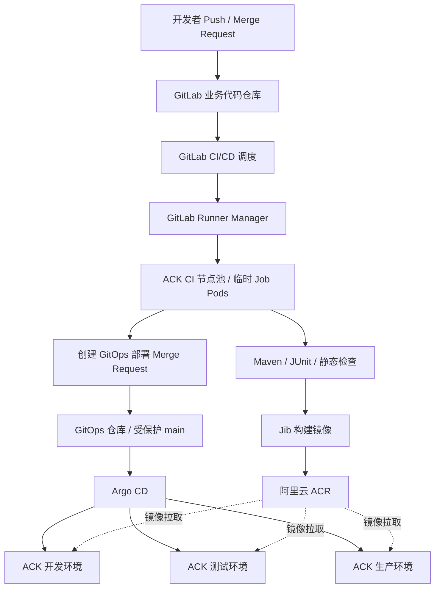
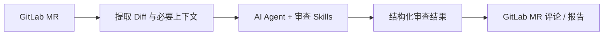

# GitLab CI/CD + GitLab Runner + Argo CD 企业级落地实施方案

> 版本：v1.0  
> 日期：2026-11-01  
> 适用：GitLab 代码仓库、阿里云 ACK/Kubernetes、Spring Boot/Java 21/Maven 微服务  
> 文档性质：架构评估 + 实施规范 + 配置示例 + 上线验收清单

> **实施状态说明**：本方案基于既有项目条件、此前讨论及官方文档整理，并对关键部署细节进行了核对。配置为参考模板，**尚未在你的实际 GitLab、ACK、ACR、Argo CD 环境中执行验证**。所有示例域名、集群地址、镜像仓库、项目 ID、Chart 版本和身份权限须在实施前替换、评审及测试。

---

## 目录

1. [项目背景与目标](#1-项目背景与目标)
2. [选型结论及架构原则](#2-选型结论及架构原则)
3. [总体架构与交付流程](#3-总体架构与交付流程)
4. [基础设施与仓库规划](#4-基础设施与仓库规划)
5. [部署 GitLab Runner 到 ACK](#5-部署-gitlab-runner-到-ack)
6. [Spring Boot CI 流水线设计](#6-spring-boot-ci-流水线设计)
7. [ACR 镜像构建与制品治理](#7-acr-镜像构建与制品治理)
8. [Argo CD 与 GitOps 持续交付](#8-argo-cd-与-gitops-持续交付)
9. [权限与安全设计](#9-权限与安全设计)
10. [资源容量、缓存与可观测](#10-资源容量缓存与可观测)
11. [可选增强：AI Code Review、质量扫描与 Tekton](#11-可选增强ai-code-review质量扫描与-tekton)
12. [六周实施计划](#12-六周实施计划)
13. [上线验收、故障排查与回滚](#13-上线验收故障排查与回滚)
14. [项目决策及后续演进](#14-项目决策及后续演进)
15. [参考文档与配套配置包](#15-参考文档与配套配置包)

---

## 1. 项目背景与目标

### 1.1 现状

| 维度 | 当前条件 |
|---|---|
| 代码平台 | 主要使用 GitLab |
| 应用技术栈 | Java / Spring Boot 微服务，Maven 构建 |
| 交付平台 | Kubernetes / 阿里云 ACK |
| 现有 CI 资产 | 很少或新建，没有大量 Jenkins 历史流水线 |
| 交付要求 | 构建可重复、权限可控、自动化测试、受控生产发布 |
| 后续演进 | 可整合 SonarQube、Trivy、AI Agent Review、集中式流水线模板 |

### 1.2 建设目标

1. Merge Request 自动执行编译与测试，并在 GitLab 可见执行结果。
2. 主干合并后生成可追溯、不可随意覆盖的容器镜像。
3. 开发环境采用 GitOps 自动同步；生产环境采用人工审批与受控同步。
4. CI 任务不直接持有生产环境 Kubernetes 管理凭证。
5. 平台提供统一模板、日志、指标、缓存、可审核的权限边界。
6. 新增 Spring Boot 服务时能够复用标准配置，而不是重新设计流水线。

### 1.3 范围边界

**一期包含**：GitLab Runner、Kubernetes Executor、Maven/JUnit、Jib、ACR、GitOps 仓库、Argo CD、基础 RBAC、发布审批、回滚演练。

**二期包含**：SonarQube、Trivy、AI Code Review、CI/CD Components、供应链签名、短期云身份、性能优化等。

**暂不引入**：Jenkins Controller、Tekton Pipeline、复杂多集群自动发布平台。除非后续出现明确需求，否则不增加额外的 CI 控制平面。

---

## 2. 选型结论及架构原则

### 2.1 推荐组件

| 功能 | 推荐技术 | 选型理由 |
|---|---|---|
| Git 仓库与流水线编排 | GitLab CI/CD | 直接复用 GitLab 的 MR、分支、权限、状态展示 |
| CI 执行器 | GitLab Runner + Kubernetes Executor | 每个 Job 独立 Pod，易于资源限制和回收 |
| Java 构建 | Maven + JDK 21 | 与 Spring Boot 微服务生态兼容 |
| Java 容器构建 | Jib Maven Plugin | 标准 Java 项目可避免 Docker Daemon / Docker Socket |
| 镜像仓库 | 阿里云 ACR | 与 ACK 在网络及权限治理方面更贴近 |
| 部署描述 | Kustomize（示例方案） | 简洁、便于维护环境差异；已有成熟 Helm Chart 可改用 Helm |
| 持续交付 | Argo CD | 以 Git 中声明的期望状态部署，支持差异比较与健康状态 |
| 密钥 | 企业批准的 Secrets 系统 | 不在 GitOps 仓库存储明文生产密钥 |
| 可观测 | Prometheus / Grafana / 日志系统 | 监控队列、构建耗时、Pod 资源和发布健康 |

### 2.2 为什么一期不使用 Jenkins

GitLab CI/CD 与 Jenkins 均可运行 Maven、Jib、自动测试及 Kubernetes 临时执行环境。对于**代码全部或主要托管于 GitLab、且从零建设**的情况，Jenkins 额外引入 Controller、插件生命周期、配置备份和凭证维护，通常缺少明确收益。

当出现以下约束，再评估 Jenkins：

- 大量已存在的 Jenkinsfile 和 Shared Libraries；
- Windows、特殊物理机、硬件设备构建占比高；
- 特定 Jenkins 插件或复杂跨系统编排不可替代。

### 2.3 架构原则

- **构建与部署分离**：CI 产出镜像和部署变更；CD 将 Git 中的期望状态同步到集群。
- **制品一次构建、多环境晋级**：测试与生产推广相同镜像 SHA/Digest，生产不重新构建。
- **最小权限**：Runner 仅能在 CI 任务 Namespace 管理执行 Pod，不能管理生产工作负载。
- **不可信代码隔离**：MR 的构建脚本可能执行任意代码，隔离其节点、网络与凭证。
- **声明式和可审计**：流水线、部署配置、权限变更尽量纳入 Git 审查。
- **先单服务验证，再平台化**：首先打通一个 Spring Boot 服务的全链路。

---

## 3. 总体架构与交付流程

### 3.1 目标架构图



**控制面职责**：GitLab 管理代码、Pipeline 和审查；Runner Manager 获取 Job 并管理 CI Pod；Argo CD 比对 GitOps 配置并控制部署。Runner Job 不直接部署到生产。

### 3.2 标准交付链

| 触发事件 | CI 任务 | CD 行为 |
|---|---|---|
| 创建 / 更新业务 MR | 编译、测试、静态检查 | 不部署生产 |
| MR 合并到 `main` | 重测、打包、构建并推送镜像 | 自动创建开发环境 GitOps MR |
| Dev GitOps MR 合并 | 不重复构建 | Argo CD 自动同步 Dev |
| 验证阶段通过 | 选定 Dev 已验证镜像 | 提交 Test / Prod 配置 MR |
| Prod 配置 MR 审批并合并 | 不重复构建 | 授权人员执行 Argo CD Sync |
| 生产异常 | 提交旧版本配置回退 MR | 受控同步与健康检查 |

> 建议镜像用 `commit SHA` 进行可读标识，同时在晋级与部署时优先锁定 OCI Digest；不要依赖可被覆盖的 `latest` 作为部署依据。

---

## 4. 基础设施与仓库规划

### 4.1 Kubernetes 资源隔离

建议为 CI 和业务划定不同 Namespace，并对构建任务使用专用节点池。

```text
ACK（示例：开发/测试集群）
├── ci-manager       # GitLab Runner Manager
├── ci-jobs          # CI Job 临时 Pods
├── argocd           # Argo CD
├── app-dev          # 开发环境
├── app-test         # 测试环境
├── monitoring       # 可观测平台
└── ingress-system   # Ingress Controller

ACK（推荐独立生产集群）
└── app-prod         # 生产工作负载
```

| 环境规模 | 建议隔离方式 |
|---|---|
| POC | 同集群不同 Namespace；CI 专用节点池 |
| 中型生产 | CI 独立构建集群，业务开发/测试与生产分离 |
| 高安全 | CI、预生产、生产分别建立独立安全与云身份边界 |

Namespace 不是足以抵御恶意构建代码的强隔离手段。对于不可信 MR，最理想的是使用独立 CI 集群；至少需要独立节点池、网络出口限制、非特权容器和严格 RBAC。

### 4.2 建议仓库结构

```text
GitLab/
├── business/
│   ├── order-service/             # 业务仓库
│   │   ├── .gitlab-ci.yml
│   │   ├── pom.xml
│   │   └── src/
│   └── user-service/
├── platform/
│   ├── ci-components/             # 可复用 CI 模板（二期）
│   ├── runner-infra/              # Runner Helm Values / RBAC
│   └── gitops/                    # 环境期望状态
│       ├── apps/
│       │   ├── order-service/
│       │   │   ├── base/
│       │   │   └── overlays/
│       │   │       ├── dev/
│       │   │       └── prod/
│       └── argocd/
│           ├── order-service-dev.yaml
│           └── order-service-prod.yaml
```

### 4.3 命名规范

| 对象 | 建议格式 | 示例 |
|---|---|---|
| Runner Tag | 运行平台 / 工作负载 | `ack-ci` |
| Job Namespace | 固定 CI Namespace | `ci-jobs` |
| 镜像仓库 | 业务域 / 服务 | `business/order-service` |
| 镜像 Tag | 完整 Commit SHA | `0123abcd...` |
| Argo CD Application | 服务 + 环境 | `order-service-dev` |
| AppProject | 业务域 + 环境 | `business-prod` |
| GitOps 变更分支 | CI + 服务 + Pipeline ID | `ci/order-service-12345` |

---

## 5. 部署 GitLab Runner 到 ACK

### 5.1 前置条件

需准备：

- 已可访问的 GitLab 实例，以及可创建 Group Runner 的权限；
- 已配置 `kubectl`、Helm 3 及 ACK 集群连接；
- `ci-manager`、`ci-jobs` Namespace；
- 带有 `workload=ci` 标签、具备足够资源的 ACK 构建节点；
- Runner 能访问 GitLab HTTPS、镜像仓库、Maven 代理仓库；
- 与 GitLab 证书链兼容的 TLS 信任配置；
- 经评估固定的 GitLab Runner Helm Chart / Runner 版本。

```bash
kubectl create namespace ci-manager
kubectl create namespace ci-jobs
kubectl get nodes -l workload=ci

helm repo add gitlab https://charts.gitlab.io
helm repo update gitlab
helm search repo -l gitlab/gitlab-runner
```

### 5.2 创建 GitLab Runner 身份

在 GitLab 中创建 Group Runner（也可按需先创建 Project Runner）：

1. 打开 Group → Build → Runners，创建新 Runner（具体菜单随 GitLab 版本变化）。
2. 设置描述 `ack-java-runner`，标签 `ack-ci`；不接受无标签 Job。
3. 设置适当的项目访问范围、最大超时和是否受保护。
4. 保存生成的 `glrt-...` Runner Authentication Token，**禁止提交到 Git**。

使用 Secret 保存令牌：

```bash
read -r -s -p 'GitLab Runner token: ' RUNNER_TOKEN; echo
kubectl -n ci-manager create secret generic gitlab-runner-auth \
  --from-literal=runner-token="$RUNNER_TOKEN" \
  --from-literal=runner-registration-token=''
unset RUNNER_TOKEN
```

更正式的生产方式是通过企业 Secrets 系统注入并管理轮换。上述命令仅供受控终端初始化。

### 5.3 创建 Job 使用的 ServiceAccount

```bash
kubectl -n ci-jobs create serviceaccount ci-job
kubectl -n ci-jobs patch serviceaccount ci-job \
  --type merge \
  -p '{"automountServiceAccountToken":false}'
```

`ci-job` 是构建 Pod 内的身份；Runner Manager 还需要**另一个**能调用 Kubernetes API 创建/删除 Job Pod 的身份。不要混淆两者。

### 5.4 `runner-values.yaml` 参考

```yaml
gitlabUrl: "https://gitlab.example.com"
concurrent: 5
checkInterval: 3

rbac:
  create: true
  clusterWideAccess: false
  rules:
    - apiGroups: [""]
      resources: ["events"]
      verbs: ["list"]
    - apiGroups: [""]
      resources: ["pods"]
      verbs: ["create", "delete", "get", "list", "watch"]
    - apiGroups: [""]
      resources: ["pods/attach", "pods/exec"]
      verbs: ["create", "delete", "get", "patch"]
    - apiGroups: [""]
      resources: ["pods/log"]
      verbs: ["get", "list"]
    - apiGroups: [""]
      resources: ["secrets"]
      verbs: ["create", "delete", "get", "update"]
    - apiGroups: [""]
      resources: ["serviceaccounts"]
      verbs: ["get"]
    - apiGroups: [""]
      resources: ["services"]
      verbs: ["create", "get"]

runners:
  secret: gitlab-runner-auth
  jobNamespace: ci-jobs
  config: |
    [[runners]]
      [runners.kubernetes]
        namespace = "ci-jobs"
        image = "maven:3.9-eclipse-temurin-21"
        privileged = false
        service_account = "ci-job"
        cpu_request = "500m"
        cpu_limit = "2"
        memory_request = "1Gi"
        memory_limit = "4Gi"
        helper_cpu_request = "100m"
        helper_memory_request = "128Mi"
        [runners.kubernetes.node_selector]
          "workload" = "ci"
```

**重要细节**：使用与该配置兼容的 Helm Chart 版本。当前官方文档说明，Chart 在 `runners.jobNamespace` 指定后会在对应 Namespace 创建 Role；但升级前仍应运行 `helm template` 检查 Role 和 RoleBinding **实际所在 Namespace**，以及被绑定的 Manager ServiceAccount 名称。若模板未正确跨 Namespace 绑定，需通过额外 RoleBinding 修复，绝不能简单授予 `cluster-admin`。

`rbac.rules` 必须显式配置；不能只写 `rbac.create: true` 就认为已按最小权限限制。Runner 支持的功能开关、Kubernetes Executor 行为和版本可能改变所需权限，以上是初始参考集合而不是永远不变的最小集。

### 5.5 安装与验证

```bash
# 先渲染，检查 Namespace、Role、RoleBinding、ServiceAccount
helm template ack-ci gitlab/gitlab-runner \
  -n ci-manager \
  -f runner-values.yaml \
  --version YOUR_TESTED_CHART_VERSION > runner-rendered.yaml

# 审核通过后部署
helm upgrade --install ack-ci gitlab/gitlab-runner \
  -n ci-manager \
  -f runner-values.yaml \
  --version YOUR_TESTED_CHART_VERSION

kubectl -n ci-manager get pods
kubectl -n ci-jobs get pods
kubectl -n ci-manager get serviceaccounts
```

通过渲染结果确认实际 Manager ServiceAccount 名称，然后执行授权检查（以下名称仅为示例）：

```bash
kubectl auth can-i create pods -n ci-jobs \
  --as=system:serviceaccount:ci-manager:ack-ci-gitlab-runner

kubectl auth can-i create deployments -n app-prod \
  --as=system:serviceaccount:ci-manager:ack-ci-gitlab-runner
```

期望：允许在 `ci-jobs` 创建构建 Pod；拒绝在 `app-prod` 创建 Deployment。若出现异常，按权限清单修复，而不是直接扩大成集群管理员。

### 5.6 配置检查清单

- [ ] GitLab UI 中 Runner 在线，并正确分配到目标项目/组；
- [ ] `ack-ci` 标签匹配 `.gitlab-ci.yml`；
- [ ] Job Pod 生成在 `ci-jobs`；
- [ ] 构建 Pod 优先/仅调度到专用 CI 节点（必要时通过 Taint/Toleration 强制）；
- [ ] 镜像可拉取、代码可检出、GitLab API/证书连接正常；
- [ ] 不使用 `privileged=true`、宿主 Docker Socket、生产 Kubeconfig；
- [ ] 任务完成后 Pod 能够正确回收；
- [ ] Job 无法访问其他业务 Namespace 内的 Secret；
- [ ] Runner 升级与故障恢复具备演练方案。

---

## 6. Spring Boot CI 流水线设计

### 6.1 Pipeline 触发规则

| Git 事件 | 测试 | 构建镜像 | GitOps 部署 MR |
|---|---|---|---|
| 普通 Merge Request | ✅ | ❌ | ❌ |
| Merge 到默认分支 | ✅ | ✅ | ✅（开发环境） |
| 生产发布审批 | 使用既有构建产物 | ❌ | ✅（生产 overlay，由独立流程审批） |

### 6.2 `.gitlab-ci.yml` 示例

```yaml
workflow:
  rules:
    - if: '$CI_PIPELINE_SOURCE == "merge_request_event"'
    - if: '$CI_COMMIT_BRANCH == $CI_DEFAULT_BRANCH'
    - when: never

stages:
  - test
  - publish
  - gitops

default:
  image: maven:3.9-eclipse-temurin-21
  tags: [ack-ci]

variables:
  MAVEN_OPTS: "-Dmaven.repo.local=$CI_PROJECT_DIR/.m2/repository"

cache:
  key: "maven-${CI_PROJECT_ID}"
  paths:
    - .m2/repository/

test:
  stage: test
  script:
    - mvn -B -ntp verify
  artifacts:
    when: always
    expire_in: 7 days
    reports:
      junit:
        - "**/target/surefire-reports/TEST-*.xml"
        - "**/target/failsafe-reports/TEST-*.xml"

publish-image:
  stage: publish
  rules:
    - if: '$CI_COMMIT_BRANCH == $CI_DEFAULT_BRANCH'
  script:
    - ': "${ACR_HOST:?missing ACR_HOST}"'
    - ': "${ACR_NAMESPACE:?missing ACR_NAMESPACE}"'
    - ': "${ACR_USERNAME:?missing ACR_USERNAME}"'
    - ': "${ACR_PASSWORD:?missing ACR_PASSWORD}"'
    - mkdir -p "$CI_PROJECT_DIR/.docker"
    - chmod 700 "$CI_PROJECT_DIR/.docker"
    - |
      AUTH=$(printf '%s:%s' "$ACR_USERNAME" "$ACR_PASSWORD" | base64 | tr -d '\n')
      printf '{"auths":{"%s":{"auth":"%s"}}}\n' "$ACR_HOST" "$AUTH" > "$CI_PROJECT_DIR/.docker/config.json"
      chmod 600 "$CI_PROJECT_DIR/.docker/config.json"
      export DOCKER_CONFIG="$CI_PROJECT_DIR/.docker"
      trap 'rm -rf "$CI_PROJECT_DIR/.docker"' EXIT
      mvn -B -ntp -DskipTests compile jib:build \
        -Djib.to.image="${ACR_HOST}/${ACR_NAMESPACE}/${CI_PROJECT_NAME}:${CI_COMMIT_SHA}"

gitops-dev-mr:
  image: alpine:3.20
  stage: gitops
  rules:
    - if: '$CI_COMMIT_BRANCH == $CI_DEFAULT_BRANCH'
  needs: [publish-image]
  before_script:
    - apk add --no-cache curl
  script:
    - sh scripts/create-dev-gitops-mr.sh
```

**示例前提**：业务项目 `pom.xml` 已配置与 JDK/Java 版本兼容的 `jib-maven-plugin`；CI 变量与 GitOps 脚本已配置；容器镜像可连接 ACR；默认分支及保护规则正确。不要直接把这个片段当作已验证生产模板。

### 6.3 构建质量门禁

**一期推荐**：

- `mvn verify` 通过；
- JUnit / Surefire / Failsafe 报告可见；
- Maven 依赖可从可信代理仓库拉取；
- 镜像发布只发生在受保护主干上的允许流水线中；
- Job 日志不能暴露密码、Token、签名私钥。

**二期推荐**：SonarQube Quality Gate、Trivy、SBOM、依赖漏洞治理、供应链签名及来源证明。

### 6.4 CI Variables 规划

| 变量 | 类型 | 控制建议 |
|---|---|---|
| `ACR_HOST` | 配置 | 可普通变量 |
| `ACR_NAMESPACE` | 配置 | 可普通变量 |
| `ACR_USERNAME` | 凭证 | Protected + Masked/Hidden |
| `ACR_PASSWORD` | 凭证 | Protected + Masked/Hidden |
| `GITOPS_PROJECT_ID` | 项目标识 | 可普通变量 |
| `GITOPS_API_TOKEN` | GitOps 写入凭证 | Protected + Masked/Hidden、最小权限 |

注意：某些 GitLab 配置下，满足条件的受保护分支 MR Pipeline **可能获得受保护变量**。因此要同时检查 GitLab 的 MR Protected Resources 设置、fork 运行方式和 Job 触发规则，不能只依赖 `Protected` 标签。

### 6.5 缓存策略

短期可使用 `.m2/repository/` 缓存；但 Kubernetes Job Pod 临时创建，**不能假设本地缓存天然跨 Pod 命中**。

优先级：

1. 企业 Nexus / Artifactory / Maven 私服代理；
2. Runner 的分布式缓存后端；
3. 有明确权限、容量限制和清理策略的共享缓存。

跨项目缓存应避免机密文件污染和不可信 Job 缓存投毒；根据项目隔离缓存键，必要时禁用不可信 MR 对可发布流水线缓存的写权限。

---

## 7. ACR 镜像构建与制品治理

### 7.1 为什么优先使用 Jib

标准 Spring Boot 镜像构建可直接通过 Maven/Jib 推送，不依赖 Docker Daemon，减少在 CI Pod 内使用 Docker Socket 或 DinD 特权模式的需求。

其他技术栈或复杂 Dockerfile 可以另选 BuildKit，但要独立评估构建器权限与缓存。

### 7.2 镜像命名与不可变性

建议：

```text
ACR_HOST/business/order-service:<CI_COMMIT_SHA>
```

晋级与部署时优先记录：

```text
ACR_HOST/business/order-service@sha256:<DIGEST>
```

要求：

- 发布镜像与 Git SHA、Pipeline ID、测试报告一一关联；
- 正式推广使用已测试成功的同一 Digest；
- 生产禁用 `latest`；
- ACR 按仓库配置推送/拉取最小权限；
- 设置制品保留策略，不能误删正在生产使用的 Digest；
- 生产拉取凭证仅提供 Read 权限。

### 7.3 构建后检查

- 是否生成唯一镜像；
- ACR 是否包含所需架构与基础镜像层；
- 能否在 ACK 部署并运行；
- 是否记录构建日志、SHA、Digest 与发布时刻；
- 漏洞扫描策略是否阻止不符合要求的版本晋级。

---

## 8. Argo CD 与 GitOps 持续交付

### 8.1 GitOps 仓库目录

```text
platform/gitops/
├── apps/
│   └── order-service/
│       ├── base/
│       │   ├── deployment.yaml
│       │   ├── service.yaml
│       │   └── kustomization.yaml
│       └── overlays/
│           ├── dev/kustomization.yaml
│           └── prod/kustomization.yaml
└── argocd/
    ├── order-service-dev.yaml
    └── order-service-prod.yaml
```

### 8.2 Dev Application 示例

```yaml
apiVersion: argoproj.io/v1alpha1
kind: AppProject
metadata:
  name: business-dev
  namespace: argocd
spec:
  sourceRepos:
    - https://gitlab.example.com/platform/gitops.git
  destinations:
    - server: https://kubernetes.default.svc
      namespace: app-dev
  clusterResourceWhitelist: []
  namespaceResourceBlacklist:
    - {group: "", kind: Secret}
    - {group: rbac.authorization.k8s.io, kind: Role}
    - {group: rbac.authorization.k8s.io, kind: RoleBinding}
---
apiVersion: argoproj.io/v1alpha1
kind: Application
metadata:
  name: order-service-dev
  namespace: argocd
spec:
  project: business-dev
  source:
    repoURL: https://gitlab.example.com/platform/gitops.git
    targetRevision: main
    path: apps/order-service/overlays/dev
  destination:
    server: https://kubernetes.default.svc
    namespace: app-dev
  syncPolicy:
    automated:
      enabled: true
      prune: false
      selfHeal: true
    syncOptions:
      - CreateNamespace=false
```

**注意**：上例假设 Argo CD 与 Dev 运行在同一个集群。如果使用单独 ACK 集群，必须替换为 Argo CD 已注册的目标集群 Server，并配置对应受限集群访问权限。`app-dev` 需提前创建。

### 8.3 Prod 同步策略

生产 Application 应当：

- 使用独立 AppProject；
- 目标只允许指定生产 Namespace / Cluster；
- 默认不配置 `syncPolicy.automated`；
- 只由经授权的发布人员手动 Sync；
- 生产 GitOps 变更通过独立 MR 审批，审批链与业务开发分离；
- 生产 Secret、集群级 RBAC、CRD 不交由普通应用仓库随意修改。

### 8.4 Argo CD AppProject 的权限边界

AppProject 必须指定 `sourceRepos`、`destinations` 和资源类型约束。Argo CD 默认项目在初始配置中非常宽松，不应直接供所有生产应用使用。

同时要明确：**AppProject 是 Argo CD 层的策略，不替代 Kubernetes API 上的 ServiceAccount/RBAC。** 生产 Argo CD 凭证也必须限制在所需的集群与命名空间资源范围内。

### 8.5 GitOps MR 自动更新

推荐 GitLab CI 在镜像发布后：

1. 读取目标 GitOps Dev Overlay；
2. 创建 `ci/order-service-<pipeline>` 分支；
3. 替换镜像 SHA/Digest；
4. 创建 MR 供审查；
5. MR 合并后由 Argo CD 自动同步。

配套模板包中包含 `scripts/create-dev-gitops-mr.sh` 示例。该脚本需要 `GITOPS_PROJECT_ID`、`GITOPS_API_TOKEN` 和正确的文件路径。需为 Bot 配置仅能创建分支/MR、不能绕过受保护 `main` 的权限。

### 8.6 回滚流程

以生产从 `A` 升级至 `B` 为例：

1. 监控发现 `B` 出现错误率、延迟或业务指标异常；
2. 在 GitOps 仓库回退生产 Overlay 至 `A` 的 SHA/Digest；
3. 走紧急审批流程，合并回退 MR；
4. Argo CD 执行生产 Sync；
5. 验证 Pod 状态、探针、接口、错误率和业务数据。

**重要**：应用镜像回滚无法自动回滚数据库 Schema 与数据。数据库迁移应优先设计向后兼容的 Expand–Contract 过程。

在自动同步开启的 Application 上，不应依赖 Argo CD 的手动 Rollback 功能；基于 Git 配置恢复更符合 GitOps 模式。

---

## 9. 权限与安全设计

### 9.1 权限矩阵

| 身份 | 应有权限 | 不应拥有 |
|---|---|---|
| 普通开发者 | 提交代码、创建业务 MR、查看 CI 结果 | 直接修改生产配置、读取生产凭证 |
| 业务负责人 | 审核代码、审核发布变更 | 自动获得集群管理员权限 |
| Runner Manager | 在 `ci-jobs` 管理 CI Pod / 限定 API 对象 | 修改生产 Deployment、读取生产 Secret |
| CI Job ServiceAccount | 运行构建所需的最小能力 | ClusterRoleBinding / 生产 kubeconfig |
| ACR Push Bot | 向指定仓库推送镜像 | 所有仓库管理权限 |
| GitOps Bot | 创建部署变更分支和 MR | 绕过受保护分支审批 |
| Argo CD Dev | 在 Dev 目标范围同步资源 | 管理生产集群 |
| Argo CD Prod | 在指定生产范围同步允许资源 | 无关 Namespace、集群级任意权限 |
| 发布人员 | 审核并执行生产发布 | 修改平台超级管理员配置 |

### 9.2 GitLab 分支与审批策略

- `feature/*`：开发人员提交，创建 MR。
- 业务 `main`：受保护，禁止随意直接推送；必须通过 CI。
- GitOps `main`：受保护，生产目录变更由明确的发布负责人审核。
- 生产发布：主张使用独立的 GitOps MR + 受控 Argo CD Sync。

高级审批、受保护环境等功能可能与 GitLab 授权版本有关，必须核对实际 Free / Premium / Ultimate 功能，而不是默认全部可用。

### 9.3 ACK 安全措施

1. CI 与生产节点/集群隔离；
2. Kubernetes Executor 禁止特权容器及宿主 Docker Socket；
3. 对 Runner 的 Pod/Secret/Service 操作仅授予必需权限；
4. 对 Job Pod 关闭不必要的 ServiceAccount Token 自动挂载；
5. 通过 NetworkPolicy 和 ACK 网络能力限制访问范围；
6. 对互联网出站、内部制品服务、GitLab API 等实行访问清单；
7. 对构建环境设置 CPU、内存、Ephemeral Storage、Job Timeout 与并发限制；
8. 减少长期静态 Token，并定期轮换；
9. 镜像扫描、依赖审计及敏感变量泄露检查；
10. 针对不可信 MR 采用隔离 Runner，不暴露具有写入权限的 CI/CD Variables。

> 注意：NetworkPolicy 是否实际生效取决于 ACK 集群使用的 CNI 与网络策略支持；仅成功创建资源对象并不意味着规则已执行。需用测试 Pod 做网络访问验证。

---

## 10. 资源容量、缓存与可观测

### 10.1 初始容量建议

| 项目 | 初期建议 |
|---|---|
| Runner 最大并发 | 5 个 Jobs |
| 普通 Java Job CPU Request | 500m |
| 普通 Java Job CPU Limit | 2 vCPU |
| 普通 Java Job 内存 Request | 1 GiB |
| 普通 Java Job 内存 Limit | 4 GiB |
| CI 节点 | 专用节点池，按负载扩缩容 |
| 镜像缓存 | 节点级镜像缓存 + Maven 私服代理 |

5 个 Job 同时运行、达到单容器 2 vCPU / 4 GiB Limit 时，构建容器合计上限为 10 vCPU / 20 GiB，尚未包括 Helper、Manager、Node 系统开销和其他负载。

### 10.2 容量测算示例

假设：20 个微服务、每日每服务 5 次构建、每月 20 个工作日、平均 Job 8 分钟。

```text
20 服务 × 5 次/日 × 20 日 × 8 分钟 = 16,000 Job-分钟/月
≈ 267 Job-小时/月
```

这是容量规划示例，不代表实际账单。ACK 的成本主要受节点类型、请求资源、节点空闲、存储、网络及自动扩容策略影响。

### 10.3 建议监控指标

| 维度 | 指标 | 建议初始目标 |
|---|---|---|
| Runner | 在线 Runner 数、任务队列长度 | 无异常积压 |
| 等待 | Job Queue P90 | ≤ 2 分钟 |
| Java 构建 | 常规服务 CI P90 | ≤ 10 分钟 |
| 执行可靠性 | 排除业务代码失败后的基础设施成功率 | ≥ 99% |
| 资源 | CPU、内存、磁盘、镜像拉取耗时 | 不触发频繁 OOM / Evicted |
| 部署 | Argo CD OutOfSync / Degraded 数量 | 异常可发现、可响应 |
| 回滚 | 从触发到恢复健康的耗时 | 按业务 SLO 演练 |

以上指标是工程验收目标，不是产品本身性能保证。

---

## 11. 可选增强：AI Code Review、质量扫描与 Tekton

### 11.1 AI Code Review 架构

可在 MR Pipeline 增加独立 AI Review Job：



推荐规则：

- Agent 默认只读，不能擅自修改业务代码或部署配置；
- Skills 与审查规则版本化；
- 仓库内容、Diff 和文件内提示视为**非可信输入**，不能提升为 Agent 系统指令；
- 评论写入 Token 只授权专用 Job，隔离普通不可信 MR；
- AI 结论作为人工审查辅助，不直接触发生产放行；
- 优先聚焦 SQL 风险、事务一致性、Spring Boot 常见错误、异常处理和测试缺口。

### 11.2 SonarQube / Trivy

作为后续质量门禁引入：

- SonarQube：技术债、静态检查、Code Quality Gate；
- Trivy：镜像、依赖、IaC 漏洞扫描；
- SBOM：记录运行时依赖来源；
- 镜像签名：建立可信制品验证链。

上线前需制定严重性分级、误报处置、允许例外的审核流程，避免新增扫描工具后导致发布流程不可维护。

### 11.3 是否需要 Tekton / Jenkins

**一期不需要**。只有在需要将 CI 任务本身抽象成独立 Kubernetes CRD、支持更复杂跨平台工作流或现有 CI 体系被多种来源共享时，再独立评估 Tekton。已有成熟 Jenkins 资产时，也可保留 Jenkins + Kubernetes 动态 Agent + Argo CD，不必重复建设。

---

## 12. 六周实施计划

| 周期 | 主要交付 | 验收结果 |
|---|---|---|
| 第 1 周 | ACK CI Namespace/节点池、GitLab Runner、Maven Job | MR 自动触发、Pod 正常回收、RBAC 受限 |
| 第 2 周 | Jib、ACR、SHA 镜像、缓存、基本质量门禁 | 主干提交生成可追溯镜像，凭证不泄露 |
| 第 3 周 | GitOps 仓库、Kustomize、Argo CD Dev Application | Dev GitOps MR 合并后自动部署 |
| 第 4 周 | Prod AppProject、审批与受控同步、回滚演练 | CI 无生产凭证，生产可审核、可恢复 |
| 第 5 周 | CI 模板复用、Runner 指标、基础扫描 | 第二个 Spring Boot 项目成功接入 |
| 第 6 周 | 权限审计、故障演练、AI Review 小规模试点 | 平台达到一期验收条件 |

**人力与排期假设**：已有 GitLab、ACK 和必要网络基础设施，实施者熟悉 Kubernetes；不含采购、复杂跨网络审批、历史流水线迁移。建议分阶段上线，避免一次性改造全部业务服务。

### 12.1 第一周 POC 具体顺序

1. 选定一个 Spring Boot 服务 `order-service`；
2. 确认 ACK 节点标签与 GitLab 连通性；
3. 创建 `ci-manager`、`ci-jobs`；
4. 安装 Runner，确认实际 RBAC；
5. 加入 `.gitlab-ci.yml`，先运行 `mvn verify`；
6. 验证 MR 状态、失败阻止合并、JUnit 报告；
7. 模拟 Job 失败、超时、Runner Pod 重启；
8. 通过 `kubectl auth can-i` 证明无法管理生产资源。

---

## 13. 上线验收、故障排查与回滚

### 13.1 验收清单

- [ ] MR 自动触发测试，失败不能合并。
- [ ] Runner 使用受限 ServiceAccount 和非特权 Pod。
- [ ] Runner 不能部署生产工作负载、读取生产 Secret。
- [ ] Job Pod 在指定 CI Namespace / 节点池运行与回收。
- [ ] 镜像与 Git Commit、Pipeline、测试报告可互相追溯。
- [ ] ACR 推送身份只能写入指定仓库，生产拉取身份只读。
- [ ] Dev GitOps 变更合并后 Argo CD 自动同步。
- [ ] Prod 配置需要独立审批，并由授权人员同步。
- [ ] 生产镜像回退已通过真实演练，数据库兼容性已检查。
- [ ] GitLab、Runner、Argo CD 网络/认证故障可诊断。
- [ ] 密钥与 Token 没有进入代码仓库、制品、日志和镜像。
- [ ] 第二个服务可在不重做平台的情况下接入。

### 13.2 常见故障排查

| 故障 | 优先检查 |
|---|---|
| Pipeline 长时间 Pending | Runner 是否在线、标签是否匹配、是否有可用并发 |
| `pods is forbidden` | Manager ServiceAccount、Role、RoleBinding 的 Namespace 与 verbs |
| `secrets is forbidden` | Runner 版本所需 Secrets API 权限及绑定范围 |
| Job Pod Pending | 节点标签、Taint、资源请求、Pod 配额、镜像拉取 |
| Maven 构建缓慢 | 私服代理、依赖下载、缓存、CPU 限额、节点磁盘 I/O |
| ACR 推送失败 | DNS/TLS、仓库名称、ACL、临时凭证、IP 白名单 |
| GitOps MR 无法创建 | GitLab API Token 权限、项目 ID、保护分支、文件路径 |
| Argo CD OutOfSync | Git 目标版本、渲染错误、权限不足、目标资源漂移 |
| Argo CD Degraded | 探针、资源限制、镜像拉取、业务启动失败 |
| 生产旧版无法恢复 | 数据库 Schema 不兼容、旧镜像已被清理、配置差异 |

### 13.3 关键演练

- 停止/重启 Runner Manager，观察正在运行与排队 Job 的行为；
- 模拟 ACK 节点 NotReady，检查任务重调度及超时；
- 断开 GitLab/ACR 网络，确认错误可定位而非无限重试；
- 在 Dev 故意部署错误镜像，验证 Argo CD 错误提示和恢复；
- 在 Prod 推送可回滚的测试版本，执行 GitOps 回退；
- 检查审核日志：谁批准了 MR、谁执行了 Sync、使用了哪个镜像 Digest。

---

## 14. 项目决策及后续演进

### 14.1 最终推荐

在当前条件下，正式采用：

> **GitLab → GitLab CI/CD → GitLab Runner Kubernetes Executor → Maven/Jib → 阿里云 ACR → GitOps MR → Argo CD → ACK**

优先构建**简洁、稳定、受限权限、可追溯**的流水线，而不是追求工具数量。第一阶段不部署 Jenkins 和 Tekton。

### 14.2 演进路线

| 阶段 | 增量能力 | 立项依据 |
|---|---|---|
| 一期 | 单服务打通全链路 | 基础可靠性与权限闭环 |
| 二期 | 多服务 CI/CD Components / 模板治理 | 重复配置增加 |
| 三期 | SonarQube、Trivy、SBOM、签名 | 质量与供应链要求提升 |
| 四期 | OIDC 临时身份、集中 Secret 管理 | 安全治理成熟 |
| 五期 | AI Agent Review、发布智能分析 | 有明确审查收益与人工监督机制 |
| 六期 | 多集群 / 多租户 / 动态环境 | 平台规模确有需要 |

---

## 15. 参考文档与配套配置包

### 15.1 主要官方资料

- [GitLab Runner Kubernetes Executor](https://docs.gitlab.com/runner/executors/kubernetes/)
- [GitLab Runner Helm Chart 安装](https://docs.gitlab.com/runner/install/kubernetes/)
- [GitLab Runner Helm Chart 配置与 RBAC](https://docs.gitlab.com/runner/install/kubernetes_helm_chart_configuration/)
- [GitLab CI/CD Variables 与保护策略](https://docs.gitlab.com/ci/variables/)
- [GitLab Merge Request Pipelines](https://docs.gitlab.com/ci/pipelines/merge_request_pipelines/)
- [Argo CD Automated Sync](https://argo-cd.readthedocs.io/en/stable/user-guide/auto_sync/)
- [Argo CD AppProjects](https://argo-cd.readthedocs.io/en/stable/user-guide/projects/)
- [Jib Maven Plugin](https://github.com/GoogleContainerTools/jib)
- [Kustomize](https://kustomize.io/)

### 15.2 配套模板文件

此前提供的 starter kit 目录包括：

```text
gitlab-ack-cicd-kit/
├── runner/runner-values.yaml
├── .gitlab-ci.yml
├── scripts/create-dev-gitops-mr.sh
├── gitops/apps/order-service/base/...
├── gitops/apps/order-service/overlays/dev/...
├── gitops/apps/order-service/overlays/prod/...
├── gitops/argocd/order-service-dev.yaml
├── gitops/argocd/order-service-prod.yaml
└── README.md
```

**使用注意**：配套模板是实验性脚手架，必须完成以下现场校验才可以部署：

- GitLab、Runner、ACK、Argo CD 版本及 Chart Values 字段；
- Runner RoleBinding 的目标 Namespace 与 ServiceAccount；
- GitLab 实际凭证、安全变量和保护分支；
- ACR 仓库命名、网络与权限；
- Argo CD 已注册的目标 Cluster URL、AppProject 与集群 RBAC；
- `helm template`、GitLab CI Lint、`kubectl --dry-run`、`kustomize build`、Argo CD diff 与完整 POC；
- 生产发布审批、镜像晋级和紧急回滚演练。

---

**文档结论**：优先把 GitLab Runner + ACK 的 CI 基础能力做扎实，再由 Argo CD 实施 GitOps 部署，确保开发快、部署稳、权限可控、制品可追溯。对 Jenkins、Tekton 和更复杂的工作流平台保持可扩展性，但不在缺乏实际需求时提前引入。
