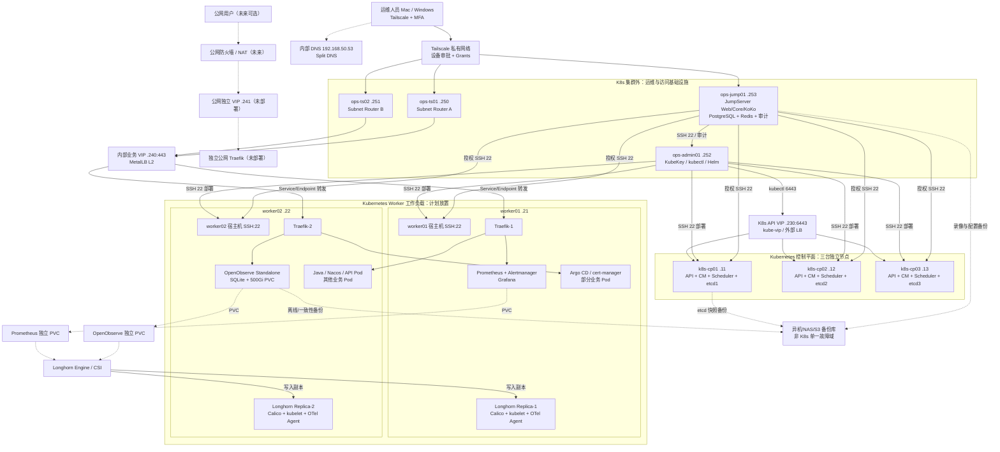
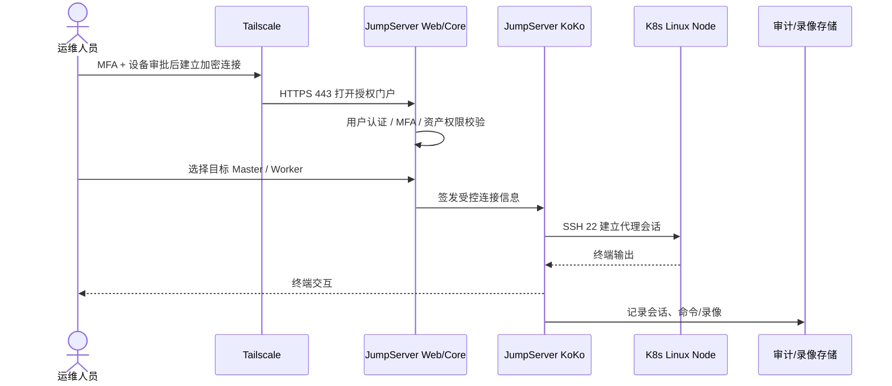
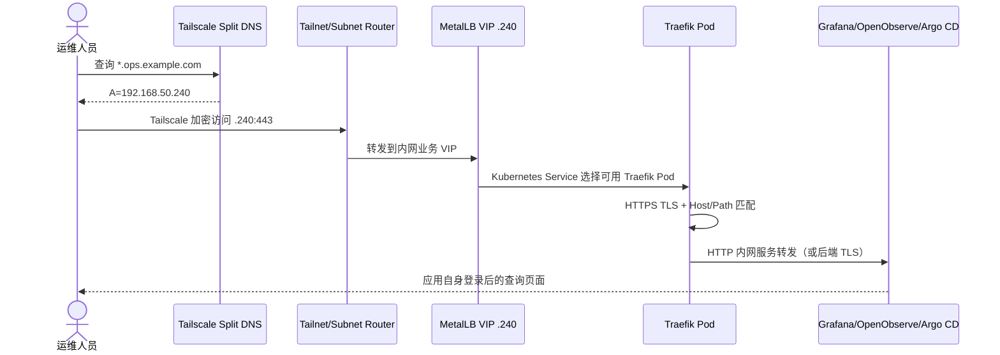
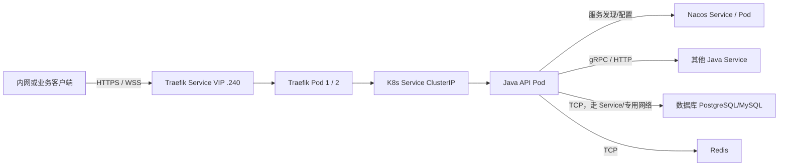
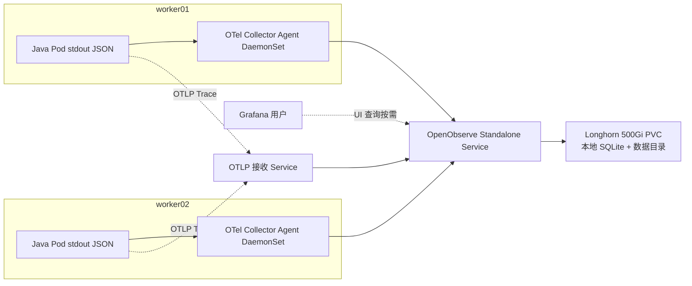
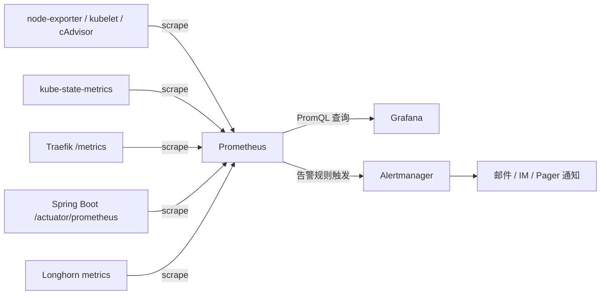
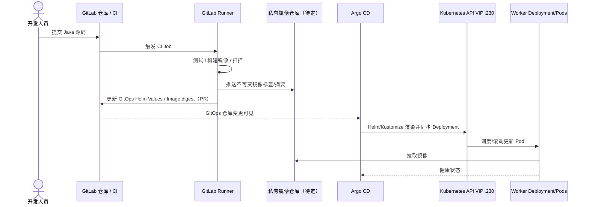

# KubeKey 私有云平台整体架构方案（节点拓扑与调用链路）

> **版本**：v1.0  |  **日期**：2026-11-03  |  **状态**：架构设计 / 待现场参数确认  
> **设计目标**：以日常维护简单、权限边界清晰、业务入口可靠、监控可用和可恢复为原则，整合此前的 KubeKey、Traefik、MetalLB、cert-manager、Longhorn、OpenObserve、Prometheus、Grafana、Tailscale 和 JumpServer 方案。  
> **基线规模**：Kubernetes **3 Control Plane + 2 Worker**；Kubernetes 集群外另有 JumpServer、Tailscale 子网路由器和 KubeKey 管理机。**建议按容量扩展第三台 Worker**，详见第 10 节。  
> **重要**：以下主机名、网段、域名、IP 和资源规格是统一后的**示例方案，不代表真实环境已部署**。执行前必须核对 IP 冲突、机器性能、现有 DNS、物理网络及 Kubernetes/Helm 配置。

---

## 目录

1. [设计原则与边界](#1-设计原则与边界)
2. [统一节点、IP、VIP 与域名规划](#2-统一节点ipvip-与域名规划)
3. [总体物理与逻辑拓扑](#3-总体物理与逻辑拓扑)
4. [每个节点部署哪些服务](#4-每个节点部署哪些服务)
5. [六条主要调用链路](#5-六条主要调用链路)
6. [关键服务之间的依赖关系](#6-关键服务之间的依赖关系)
7. [网络与端口矩阵](#7-网络与端口矩阵)
8. [高可用、单点故障与恢复路径](#8-高可用单点故障与恢复路径)
9. [安全边界与权限设计](#9-安全边界与权限设计)
10. [资源容量与扩容建议](#10-资源容量与扩容建议)
11. [部署实施阶段与验收标准](#11-部署实施阶段与验收标准)
12. [日常运维与变更流程](#12-日常运维与变更流程)
13. [架构决策与尚待确认事项](#13-架构决策与尚待确认事项)
14. [参考文档与官方资料](#14-参考文档与官方资料)

---

## 1. 设计原则与边界

### 1.1 核心选型

| 能力 | 组件 | 实施方式 / 职责 |
|---|---|---|
| K8s 部署与生命周期 | **KubeKey 4.x** | 在独立管理机执行 CLI；不是集群内常驻网关 |
| K8s 控制平面 HA | kube-apiserver、controller-manager、scheduler、**3 节点 etcd** | 3 个 Master；API 独立 VIP 或外部 LB |
| Pod 网络 | Calico + kube-proxy（按 KubeKey 实际配置） | Pod 间通信、Service 转发、NetworkPolicy |
| 裸金属业务入口 IP | **MetalLB L2** | 为内部 Traefik Service 分配固定 VIP |
| HTTP(S) 七层入口 | **Traefik v3，2 副本** | Ingress / HTTPS / WebSocket / HTTP 路由 |
| HTTPS 证书 | **cert-manager** | DNS-01 自动签发并续期，将证书放在 TLS Secret |
| 持久化卷 | **Longhorn** | 当前 2 个存储 Worker 时先用双副本；适配 CSI 与备份 |
| 基础监控与告警 | **Prometheus + Grafana + Alertmanager** | K8s、节点、JVM、Traefik 指标与独立告警 |
| 日志与链路 | **OTel Collector + OpenObserve Standalone** | 原始日志约 20 GB/天，日志保留 15 天；Trace 7 天 |
| 应用配置与注册 | **Nacos** | Java 服务配置和服务发现；3 节点高可用建议至少 3 个独立 Worker 故障域 |
| 应用发布 | **GitLab CI/Runner + Argo CD + Helm** | CI 构建镜像；GitOps 部署到集群 |
| 远程私人网络 | **Tailscale** | 运维人员到 JumpServer、内部 Web VIP 的加密访问 |
| 堡垒机与审计 | **JumpServer Community** | 集群外独立虚拟机，SSH/资产授权/会话审计 |
| 数据备份 | **异机/NAS/S3 兼容备份库** | etcd、Longhorn 卷、JumpServer 状态与录像；须位于独立故障域 |

### 1.2 设计约束

- **K8s 集群故障不应同时摧毁运维入口**：Tailscale 子网路由器和 JumpServer 不放在被管理的 K8s 中。
- **控制面入口与业务入口完全分离**：`192.168.50.230:6443`（K8s API）≠ `192.168.50.240:443`（Traefik）。
- **公网业务与内部管理面分离**：当前基线仅内网/VPN管理入口；将来公网业务采用独立 Traefik 实例及 VIP，而不是仅靠不同域名隔离。
- **Kubernetes Pod 不是固定绑定物理机的进程**：下表是计划放置/期望实例分布；最终由调度器决定，必须用 requests、拓扑分散和亲和性策略实现。
- **“双副本”不等于所有组件 HA**：OpenObserve Standalone、JumpServer、部分 Prometheus/Argo CD 仍存在单点，允许计划内短时中断；核心 K8s API 使用 HA。
- **业务数据不从 Tailscale 传输到可观测后端**：Tailscale 只负责“人访问运维系统”，OpenTelemetry 在 K8s 内网传送采集数据。

---

## 2. 统一节点、IP、VIP 与域名规划

### 2.1 物理服务器 / 独立虚拟机清单

> 与此前各专项文档示例不一致的地址，以**本文件统一示例**为准；实际已上线环境不得为适配本文件而擅自更换地址。

| 节点 | 示例 IP | 规格起点 | 部署角色 | 故障影响 |
|---|---|---|---|---|
| `k8s-cp01` | `192.168.50.11` | 8C16G / 200G SSD | Control Plane、etcd-1、kube-vip 候选 | 其余 2 个 etcd 节点可维持法定多数 |
| `k8s-cp02` | `192.168.50.12` | 8C16G / 200G SSD | Control Plane、etcd-2、kube-vip 候选 | 同上 |
| `k8s-cp03` | `192.168.50.13` | 8C16G / 200G SSD | Control Plane、etcd-3、kube-vip 候选 | 同上 |
| `k8s-worker01` | `192.168.50.21` | **建议 16C32G** / OS 200G + 数据 SSD ≥1.5TiB | Traefik-1、监控平台、部分业务、Longhorn 副本 | 负载迁移到 Worker02，可能资源不足 |
| `k8s-worker02` | `192.168.50.22` | **建议 16C32G** / OS 200G + 数据 SSD ≥1.5TiB | Traefik-2、OpenObserve、部分业务、Longhorn 副本 | OpenObserve 中断，恢复受其他 Worker 资源影响 |
| `ops-jump01` | `192.168.50.253` | 4C16G / 系统 60G + 数据 200–300G | JumpServer、Docker Compose、PostgreSQL/Redis、Tailscale 客户端 | 堡垒机不可用，需应急带外访问 |
| `ops-ts01` | `192.168.50.250` | 2C2G / 20G | Tailscale Subnet Router A | 由 B 接替相同 `/32` 路由 |
| `ops-ts02` | `192.168.50.251` | 2C2G / 20G | Tailscale Subnet Router B | 由 A 接替相同 `/32` 路由 |
| `ops-admin01` | `192.168.50.252` | 2–4C / 4–8G / 80G | KubeKey、kubectl、Helm、维护脚本、GitLab 受控运维执行器 | 影响部署/维护操作，不影响已有业务 |
| `ops-dns`（已有或另建） | `192.168.50.53` | 按现有 DNS 平台 | 运维域名 A 记录与 Split DNS | 远程域名解析失败，须冗余或缓存策略 |
| `backup-store`（已有或另建） | **待定** | 按总备份量配置 | 异机备份存储 | 恢复能力下降，业务不一定立即中断 |
| **可选 `k8s-worker03`** | `192.168.50.23` | 16C32G / 数据 SSD ≥1TiB | 业务/Longhorn 第 3 故障域；为 Nacos 与可观测隔离 | 可显著改善集群容量与存储容错 |

**当前最少节点数**：5 台 K8s 节点 + 1 台 JumpServer VM + 1 台 Tailscale Router VM；**推荐运维完整型**：5 台 K8s + 4 台独立 VM（2× Router + JumpServer + 管理机），另外复用已有 DNS/备份。VM 应尽量分布在不同物理宿主机，避免“逻辑双机、实际同一宿主机”造成虚假 HA。

**现有规格兼容说明**：此前生产部署文档中的 Worker 基线为 8C16G。在 20 GB/天日志及 Java 微服务并行运行时，**不能据此认为 8C16G 足够**；必须根据真实资源 requests、CPU 峰值和日志查询压测调整，推荐扩容到 16C32G 起或者加 Worker03。

### 2.2 VIP、CIDR、端口

| 资源 | 示例 | 所属组件 | 说明 |
|---|---|---|---|
| 节点 LAN | `192.168.50.0/24` | 物理机房 | 网关例 `192.168.50.1`，确认路由和 VLAN |
| **K8s API VIP** | **`192.168.50.230`** | kube-vip / 专用外部 LB | TCP **6443**；控制面 VIP；三台 Master 可用 |
| **内网 Traefik VIP** | **`192.168.50.240`** | MetalLB L2 Service | TCP **443**、按需 80；只对 LAN / Tailscale 可达 |
| **公网业务 VIP（可选）** | **`192.168.50.241`** | 第二套专用 Traefik + MetalLB | 有公网服务需求再创建；公网 IP/NAT → `.241:443` |
| Pod CIDR（示例） | `10.233.64.0/18` | CNI | 以 KubeKey 实际 `config.yaml` 为准 |
| Service CIDR（示例） | `10.233.0.0/18` | kube-apiserver | 与 Pod CIDR / LAN 不重叠，以上为互不重叠示例 |
| Tailscale overlay | Tailscale 自动分配的 100.x 地址 | Tailnet | 不自行手工分配；走设备审批和 Grants |

> `192.168.50.230` 是本文件选定的统一**示例** API VIP；旧文档中 `.10`、`.100`、`.200` 的 API VIP 仅代表各自独立示例，不能同时使用。尤其 `.10` 在旧文档中还曾被当作管理机地址，存在冲突。本文件管理机统一为 `.252`。

### 2.3 内部域名

| 名称 | 内网 / Split DNS 记录 | 流量终点 |
|---|---|---|
| `api.k8s.internal` | `192.168.50.230` | kube-apiserver 6443，仅运维网络使用 |
| `grafana.ops.example.com` | `192.168.50.240` | Traefik → Grafana Service |
| `openobserve.ops.example.com` | `192.168.50.240` | Traefik → OpenObserve UI Service |
| `argocd.ops.example.com` | `192.168.50.240` | Traefik → Argo CD Server |
| `nacos.ops.example.com`（可选） | `192.168.50.240` | Traefik → Nacos UI；后台配置协议不经此入口 |
| `jump.ops.example.com` | JumpServer Tailscale 设备 IP | **直接到 JumpServer HTTPS**，不走 Traefik |
| `api.example.com`（未来公网） | 公网可达 IP（非 `192.168.50.*`） | 公网 NAT/LB → 独立公网 Traefik VIP `.241` |

`example.com` 仅为文档示例域名。管理域名 HTTPS 建议使用 `cert-manager + ACME DNS-01`；`jump.ops.example.com` 证书由 JumpServer 宿主机独立维护（可用受信任证书和 DNS-01），避免 K8s 故障影响堡垒机证书续期。**内网 DNS 不等于安全边界。**

---

## 3. 总体物理与逻辑拓扑

### 3.1 总体架构图（主要节点、角色和调用关系）

> Mermaid 可直接在支持 Mermaid 的 Markdown 编辑器或 GitLab Markdown 中查看；颜色不代表固定网络区域。实线为主要访问，虚线为管理/可观测/依赖链路。



**特别说明**：MetalLB L2 下，一个 VIP 由**单个节点负责 ARP/NDP 宣告**，不意味着流量同时从两个节点进入。`externalTrafficPolicy: Cluster` 时，流量可以再由 Service 转发给两个 Traefik Pod；真实行为取决于实际 Service 策略、CNI 和 kube-proxy 组件。不要将 VIP 宣告节点固定写死成 Worker01。公网入口图为未来扩展，**不是已经开启的公网端口**。

### 3.2 节点关系的纯文本版（任何 Markdown 阅读器都可读）

```text
[运维终端] --Tailscale--> [JumpServer .253] --SSH:22--> [K8s CP / Worker]
        |                      |
        |                      +--SSH:22--> [KubeKey 管理机 .252]
        |
        +--Tailscale--> [子网路由 A .250 或 B .251]
                             |
                             +--> [内网 Traefik VIP .240:443]
                                         |
                                         +--> Grafana / OpenObserve / Argo CD
                                         +--> 内部 Java API / Nacos UI

[KubeKey 管理机 .252] --SSH:22--> 5 个 K8s 节点
[KubeKey 管理机 .252] --API VIP .230:6443--> 3 Master 的 API Server

[3 x Master] = Kubernetes API + Scheduler + Controller Manager + etcd 三节点
[2 x Worker] = Traefik x2 + 应用 Pod + OpenObserve x1 + Prometheus x1
               + OTel Collector Agent x2 + Longhorn 数据副本 x2

[GitLab] --构建/推送--> [镜像仓库]
[GitLab GitOps 仓库] --读取同步--> [Argo CD] --K8s API--> [应用 Deployment]

[Java stdout] --> [OTel DaemonSet] --> [OpenObserve] --> 日志/Trace 查询
[各 Exporter/Micrometer] <--定时抓取-- [Prometheus] --> [Grafana]
[Prometheus] --> [Alertmanager] --> 告警渠道
```

---

## 4. 每个节点部署哪些服务

### 4.1 控制平面：`k8s-cp01`、`k8s-cp02`、`k8s-cp03`

| 节点 | OS/运行时 | 常驻 Kubernetes 服务 | 额外系统组件 | 原则 |
|---|---|---|---|---|
| cp01 `.11` | Ubuntu、containerd、kubelet | kube-apiserver、kube-controller-manager、kube-scheduler、etcd member 1 | Calico node、kube-proxy（如果启用）、kube-vip（如选择） | 不混部 Java、OpenObserve、CI 构建 |
| cp02 `.12` | 同上 | API / CM / Scheduler / etcd member 2 | 同上 | 保持控制面可用 |
| cp03 `.13` | 同上 | API / CM / Scheduler / etcd member 3 | 同上 | 保持控制面可用 |

- 3 个 etcd 成员以 **etcd peer TCP 2380** 通信，使用 **TCP 2379** 服务 Kubernetes API 等控制面客户端；它们组成一个 quorum，不是 3 套独立数据库。
- Kubernetes API 对外统一使用 `.230:6443`，需要在实际环境部署 kube-vip 或外部 LB；**KubeKey Inventory 里写一个 VIP 并不会自动证明 VIP 可用**。
- CoreDNS、metrics-server、cert-manager 等一般是 K8s workload Pod，按调度策略运行在 Worker，并非固定运行在 Master；CoreDNS 应至少 2 副本。
- 建议对 Master 保留 `NoSchedule` taint，不把监控高 IO、有状态工作负载或 CI Runner 压到控制平面。

### 4.2 Worker 计划放置清单（当前 2 台）

| 工作负载 | worker01 `.21` | worker02 `.22` | 副本/类型与说明 |
|---|---|---|---|
| kubelet/containerd/Calico | ✅ | ✅ | 每节点系统常驻 |
| MetalLB speaker | ✅ | ✅ | DaemonSet；只在符合条件的节点调度 |
| MetalLB controller | 计划 ✅ | 备用可调度 | 1 副本；非 HA；可重建，通常不在持续转发数据平面上 |
| **Traefik** | **Pod 1** | **Pod 2** | 2 副本，跨 Worker 强制反亲和；升级前检查滚动策略 |
| cert-manager（controller/webhook/cainjector） | 计划 ✅ | 可调度 | 具体 Pod 的分布由调度器决定 |
| CoreDNS | Pod 1（期望） | Pod 2（期望） | 2 副本，跨节点分散 |
| Argo CD | 计划 ✅ | 可调度 | 初期单套安装；controller/repo/server 各组件的副本数以实际 Helm 配置为准 |
| **Prometheus** | **优先** | 故障后可调度 | 单副本 StatefulSet，约 100Gi PVC；有恢复时间 |
| Grafana + Alertmanager | 优先 | 可调度 | 各单副本；相关 PVC 需要可重挂载 |
| **OpenObserve** | 故障迁移目标 | **优先** | Standalone 单副本，约 500Gi PVC；只在一个节点运行 |
| OTel Collector（logs/OTLP） | DaemonSet Pod | DaemonSet Pod | 每节点各 1；需要日志主机目录挂载和失败重试 |
| node-exporter | DaemonSet Pod | DaemonSet Pod | Prometheus 拉取节点指标；Master 上按部署配置也可运行 |
| kube-state-metrics | 计划 ✅ | 可调度 | K8s 资源状态指标 |
| Java Spring Boot | 部分 Pod | 部分 Pod | 业务 Deployment 应设置反亲和 / TopologySpreadConstraints |
| Nacos | **不保证 HA** | **不保证 HA** | 3 个 Nacos 副本放在仅 2 个 Worker 上，不能保证任意一个 Worker 故障后仍保有 2/3 多数；优先加第 3 Worker |
| Longhorn CSI/Manager | ✅ | ✅ | 引擎/副本根据卷调度和附件状态变化 |
| Longhorn 数据副本 | Replica A | Replica B | 两存储节点建议 `numberOfReplicas: 2`；节点故障后降级 |
| GitLab Runner | **不建议与高峰业务混部** | 按需少量 | 建议单独 Runner VM/Node，或限制 CI 构建资源并设置专门节点池 |

> **这是目标布局而不是静态承诺**。使用 `nodeSelector/affinity/topologySpreadConstraints` 固定 Traefik 两个副本分散；OpenObserve **不要使用不可恢复的硬性 nodeSelector**，否则 worker02 故障时可能因调度约束无法迁移。Longhorn 副本的实际位置需由其自身调度策略验证，不能按表格推断。

### 4.3 JumpServer 独立节点 `ops-jump01`

```text
ops-jump01 (.253)   Ubuntu 24.04  |  Docker + Compose
├── Tailscale Client（设备接入 Tailnet，非 Subnet Router）
├── JumpServer Web / Nginx         HTTPS:443，运维人员 UI
├── JumpServer Core                用户/组织/资产/授权/API
├── JumpServer KoKo                SSH 会话代理及录像（按需 2222）
├── PostgreSQL                     身份与资产元数据（仅容器内部）
├── Redis                          会话/缓存/任务（仅容器内部）
└── /data/jumpserver               持久卷、录像、配置与日志
    └── 异机加密备份（非 K8s 内的唯一备份）
```

按社区版安装器实际启动的容器为准，未用到的 RDP、数据库代理组件不必对外开放。**JumpServer 不直接承担 Kubernetes 的数据面流量，也不应保管所有开发人员的超级管理员 kubeconfig**。其 SSH 目标只开放经过授权的节点/端口。

### 4.4 Tailscale Router 节点 `ops-ts01` / `ops-ts02`

```text
ops-ts01 (.250)                             ops-ts02 (.251)
├── Ubuntu + tailscaled                     ├── Ubuntu + tailscaled
├── IPv4 forwarding                        ├── IPv4 forwarding
└── 宣告 .240/32 + .53/32                   └── 宣告相同的 .240/32 + .53/32
         \________________________________________/
             Tailnet 批准 + Grants + 同前缀故障接替
```

- 不宣告整个 `192.168.50.0/24`、K8s Pod CIDR 或 Service CIDR。
- 若 `192.168.50.53` DNS 尚未真实部署，先只宣告 `.240/32`。
- JumpServer 自身**直接**注册为 Tailscale 设备，不必经过子网路由器。

### 4.5 管理机 `ops-admin01`

```text
ops-admin01 (.252)
├── KubeKey CLI（固定版本）
├── ansible / ssh / rsync（可选）
├── kubectl / helm / k9s
├── Inventory / Config / Git 工作区
└── 有访问限制的 CI 或人工维护执行入口
```

- KubeKey：管理 K8s **安装、升级、扩缩容**，基于 SSH 到节点；其管理操作应有变更审批。
- kubectl / Helm：通过 `.230:6443` 对 API 发送变更。
- JumpServer → 管理机仅给少数平台管理员开放 SSH；`kubectl` 使用按个人映射的 Kubernetes RBAC 或隔离的短期凭据；集群超级管理员凭据应加密离线保管。

---

## 5. 六条主要调用链路

### 5.1 链路 A：远程运维人员登录服务器（带会话审计）



**安全边界**：用户不应绕过 JumpServer 直接连 K8s 节点；机房防火墙仅允许 `ops-jump01`、受控管理机及应急通道访问节点 SSH。JumpServer 记录终端会话，但对 Kubernetes API 层级的变更仍需 `kube-apiserver audit` 和 Git 审计。

### 5.2 链路 B：远程查看 Grafana / OpenObserve / Argo CD



- Tailscale Grants 控制“谁能到 `.240:443`”；**无法单凭该端口区分 Grafana 和 Argo CD 的 Hostname**。
- Grafana、OpenObserve、Argo CD 各自还要登录授权，必要时给 Traefik 配置 ForwardAuth/OIDC。
- 运维界面的 TLS Secret 由 cert-manager 提供，使用 DNS-01 签发；对公网**不开放** `.240:443`。

### 5.3 链路 C：业务 HTTP/HTTPS → Java 微服务 → Nacos / 数据库



**说明**：Nacos 注册和配置访问通常是 **Java Pod → Nacos 的 ClusterIP / 内部地址**，不是 Java Pod → Traefik → Nacos。数据库和 Redis 没有因部署 Traefik 就自动变成公网资产；业务服务优先 ClusterIP 或专用数据网络。生产数据库是否自建 K8s、使用外部专用 VM 或云数据库，当前尚未确定，故图中仅保留逻辑依赖。

### 5.4 链路 D：应用日志和 Trace 采集



- 初期 OTel Agent 可直接发送 OpenObserve 的集群内部写入端点；若后续有复杂采样/过滤、故障缓冲需求，再增加单独 **OTel Gateway Deployment**，不要为了架构图好看而强制引入。
- OTel Collector 采集端必须配好认证 Secret、合理批量发送、重试和队列；如需断电后尽可能不丢数据，需验证持久化队列的卷/目录配置。**允许短暂中断不等于保证 0 丢日志**。
- 原始日志 **20 GB/天**；OpenObserve 初期 **500Gi PVC** 和 **15 天日志保留**，Trace 初期保留 7 天。存储实际增长依赖压缩比、查询缓存、WAL、队列和保留策略，需上线后监测。
- OpenObserve Standalone 默认可采用 SQLite + 本地数据目录，**不依赖 PostgreSQL/NATS/MinIO**；它不是 HA。

### 5.5 链路 E：指标监控和告警（与日志平台解耦）



> 箭头箭头语义：这里的 `scrape` 实际由 **Prometheus 主动 HTTP 拉取 Exporter**，不代表 exporter 主动推送；图为了表现依赖关系采用“指标源 → Prometheus”。

关键告警（K8s Node NotReady、etcd quorum、磁盘空间、Pod CrashLoop、Traefik 5xx、Longhorn 降级、OpenObserve 不可用）尽量基于 Prometheus/Alertmanager；**不要让 OpenObserve 故障连带使核心监控不可见**。

### 5.6 链路 F：CI/CD 与变更交付



- 建议 **GitLab Runner 放独立资源池**；初期必须给构建任务 CPU/内存/并发上限。
- GitLab、镜像仓库、Nexus 的**实际运行位置当前未确定**，不可在节点表中擅自把它们标为已部署。可以是已有独立 GitLab/Registry 服务；若准备内部部署需另行规划存储、HA、备份。
- Argo CD 是持续运行的集群内服务，KubeKey 则是低频使用的集群管理工具；不要将两者混为一谈。

---

## 6. 关键服务之间的依赖关系

### 6.1 分层依赖

```text
[物理交换机/VLAN/网关/DNS/NTP]
      |
      +--> [Ubuntu + containerd + kubelet + Calico]
                |
                +--> [3 CP + etcd quorum + API VIP]
                |         |
                |         +--> [Kubernetes API 和 Service/Pod 调度]
                |                    |
                |                    +--> [MetalLB L2 -> Traefik -> 各应用]
                |                    +--> [Longhorn CSI/PVC]
                |                    +--> [cert-manager -> TLS Secret]
                |                    +--> [Prometheus / Grafana / Alertmanager]
                |                    +--> [OTel Collector -> OpenObserve]
                |                    +--> [Argo CD -> Java/Nacos 业务]
                |
                +--> [JumpServer / Tailscale：集群外运行，独立故障域]
```

### 6.2 依赖与容量关注点

| 组件 | 强依赖 | 重要的非依赖 | 容灾影响 |
|---|---|---|---|
| kube-apiserver | etcd quorum、节点网络、证书 | OpenObserve、Grafana、Traefik | API VIP 或 etcd 损坏，无法正常管控集群 |
| Traefik | K8s Service/Endpoint、网络、TLS Secret | JumpServer、OpenObserve | 管理 Web/业务入口受影响 |
| OpenObserve | 持久卷、本机 CPU/RAM、Collector 数据流 | Kubernetes API（运行中的已有 Pod 可短时继续服务）、JumpServer | 允许短时查询/写入中断；恢复需要 PVC 完整 |
| Prometheus | Exporter 目标、自己的 TSDB PVC | OpenObserve | 指标采集、基础告警独立 |
| JumpServer | 自身 Core、PostgreSQL、Redis、宿主机存储 | Kubernetes、Traefik | JumpServer 故障不能阻断带外应急访问 |
| Tailscale Router | Tailnet 出站、LAN 到 VIP 路由、Grants | Kubernetes 业务 Pod 内部流量 | 两路由器相同前缀故障切换 |
| cert-manager | K8s API、ACME/DNS API、DNS 权限 | JumpServer 证书 | 证书续期失败需提前预警 |
| Longhorn | 可用存储节点、数据盘、CSI/Engine | Tailscale | 两副本丢失一台时降级，必须尽快恢复冗余 |

### 6.3 哪些服务必须保持独立

1. **JumpServer 与 K8s 集群**：独立 VM，独立存储/恢复路径。
2. **API VIP 与 Traefik VIP**：不同地址，不依赖业务网关代理 Kubernetes API。
3. **OpenObserve 与 Prometheus/Alertmanager**：日志系统坏掉时仍应发出故障告警。
4. **业务公网入口与运维私网入口**：两个不同的 VIP/Traefik（如果将来需公网业务）。
5. **备份库与运行卷**：备份不能只放在被备份的同一 Longhorn 集群中。

---

## 7. 网络与端口矩阵

| 来源 | 目标 | 端口/协议 | 备注 / 访问原则 |
|---|---|---|---|
| 远程运维终端（Tailnet） | JumpServer 的 Tailscale 设备 IP | TCP 443；可选 2222 | 强制 MFA、设备审批、Grants |
| 远程运维终端（Tailnet） | Router A/B → `.240` | TCP 443 | 仅内部运维 UI；不暴露整个 `/24` |
| 远程运维终端（Tailnet） | `.53`（通过 Router） | UDP/TCP 53 | 仅已使用内部 DNS 的情况下 |
| JumpServer `.253` | K8s CP `.11–.13`、Worker `.21–.22` | TCP 22 | 仅授权 SSH 管理 |
| JumpServer `.253` | ops-admin `.252` | TCP 22 | 仅平台管理员 |
| ops-admin `.252` | 全部 K8s 节点 | TCP 22 | KubeKey 管理；按需限时开放 |
| ops-admin `.252` | K8s API VIP `.230` | TCP 6443 | kubectl/Helm，严格 RBAC |
| Master 节点互相 | etcd peers | TCP 2379/2380 | 仅控制平面互通 |
| 所有 K8s 节点 | API VIP / API Server | TCP 6443 | kubelet / 控制面访问 |
| MetalLB speaker | 同 LAN 邻居 | ARP/NDP、成员通信 | L2 VIP 宣告；成员端口以安装配置为准 |
| 内部业务客户端 | Traefik VIP `.240` | TCP 443（必要时 80） | TLS 终止；WebSocket 走 WSS |
| Traefik Pod | 后端 Service / Pod | 按实际服务端口（如 8080） | 业务入口到应用 |
| Java Pod | Nacos / DB / Redis | Nacos 常见 8848、9848；DB/Redis 按实际 | 以版本、部署模式、端口清单为准；默认不暴露公网 |
| OTel Agent | OpenObserve ClusterIP | OTLP/HTTP 等实际接收端口 | 集群内部认证、重试/批处理；不用 Ingress 中转采集 |
| Prometheus | Node/JVM/Traefik Exporters | exporter 实际 scrape 端口 | HTTP pull，尽量限制命名空间与来源 |
| Alertmanager | 告警接收通道 | 按 SMTP/Webhook/IM API | 仅必要出站 |
| cert-manager | ACME 服务 / DNS 提供商 API | TCP 443；DNS 查询 53 | DNS-01 证书续期 |
| JumpServer / etcd / Longhorn 备份任务 | 异机备份库 | 22 / 443 / NFS 等 | 最小权限、加密、独立故障域 |

**端口矩阵是实施检查基线，不是完整的 Kubernetes 内部端口白名单。** Calico、kubelet、kube-proxy、CoreDNS、Longhorn 节点间复制及健康检查端口还需逐项核对发行版和实际 Helm values。不要以为只开放上表就能启动集群。

---

## 8. 高可用、单点故障与恢复路径

### 8.1 关键故障场景表

| 故障场景 | 预期现象 | 自动恢复能力 | 需要执行的操作 |
|---|---|---|---|
| 1 台 CP 宕机 | API/etcd 法定多数仍在 | 有条件自动容错 | 修复 CP，确认 etcd member/learner、API VIP 正常 |
| 2 台 CP 同时宕机 | etcd 失去多数 | 无 | 进入 etcd 灾难恢复流程，不要盲目强制重新初始化 |
| worker01 宕机 | Traefik 仍可能有 1 副本，Prometheus 可能迁移 | 部分可恢复 | 检查 Pod 重新调度、Longhorn 卷健康和容量 |
| worker02 宕机 | OpenObserve 不可用，Traefik 仍有 1 副本 | 取决于 PVC、调度空间 | 恢复节点或在 worker01 重挂载 PVC；期间可能中断/丢采集数据 |
| MetalLB L2 宣告节点宕机 | VIP 短时不可达 | 支持故障接替 | 确认新 L2 宣告及 ARP 缓存收敛 |
| Tailscale Router A 宕机 | VPN 到内部 Web VIP 短时中断 | Router B 同前缀可接替 | 验证二者路由均已批准且未错误接受自宣告路由 |
| JumpServer 宕机 | SSH 会话与 Web 堡垒机不可用 | 无（单节点） | 使用带外应急通道，恢复独立 VM/数据库/录像 |
| OpenObserve PVC 故障 | 日志/Trace 写入查询失败 | Longhorn 仅有特定副本冗余 | 验证可用数据副本，禁止盲删 PVC，使用备份恢复 |
| Longhorn 一台存储 Worker 故障 | 副本降级 | 取决于存储卷可访问性 | 及时修复/重建副本、检查额外存储空间 |
| DNS 或证书到期 | HTTPS 登录失败 | 部分缓存/续期可恢复 | 校验 DNS-01、Issuer/Certificate、证书链和告警 |
| 机房断电/整站失效 | 所有本地 VM/物理机不可用 | 无同站点 HA | 依赖异地备份与恢复环境；不是跨机房 DR |

### 8.2 重要恢复路径

- **Kubernetes**：保留 KubeKey `inventory.yaml` / `config.yaml` 的 Git 版本 + etcd 定时快照；KubeKey 备份 kubeadm 配置**不等于**备份 etcd。
- **OpenObserve**：Standalone SQLite + 数据目录要求一致性备份；优先停止写入后做备份，或使用被验证的一致性快照流程；一定包含业务数据、元数据、配置与权限。
- **Longhorn**：周期快照 + 备份至集群外 NFS/S3；同集群内副本不是独立备份。
- **JumpServer**：备份 PostgreSQL、安装配置密钥、录像及附件至异机；独立定期执行**完整恢复演练**。
- **Prometheus/Grafana**：TSDB 及 PVC 保留、Grafana Dashboard/数据源/告警规则尽可能 GitOps 化；监控可重建优先，不应因监控故障阻碍业务恢复。
- **Tailscale**：运营账号 MFA、备用管理员、节点/路由审批清单、带外管理链路是核心恢复材料。

---

## 9. 安全边界与权限设计

### 9.1 分层权限模型

| 层 | 身份 / 控制 | 应允许的动作 | 默认禁止 |
|---|---|---|---|
| 设备接入 | Tailscale SSO/MFA + Device Approval | 已审批终端加入 Tailnet | 未审批设备访问 |
| 网络路由 | Tailnet Grants + 路由批准 | 指定 Ops 访问 JumpServer 443 / 内网 VIP 443 | 全网段 `/24` 访问、直连数据库与 API |
| 堡垒机 | JumpServer 用户/组/资产授权、MFA | 授权 SSH 资产、查看会话录像 | 共用管理员账户、跳过审计直连节点 |
| Linux 主机 | 独立 SSH 公钥 + sudo 最小化 | 按岗位登录 Worker/CP/管理机 | root 口令共享、无审计永久 sudo |
| Kubernetes | kube-apiserver RBAC + Audit | 按 namespace / verb 授权 | 常态共享 `admin.conf`/cluster-admin |
| Web 管理平台 | 各应用账号权限/OIDC（按版能力） | 指定看板、日志查询、发布角色 | 通过同一 VIP 免登录访问管理数据 |
| 应用数据 | K8s Secret、密钥系统与 NetworkPolicy | 只允许业务 Pod 访问其 DB/Nacos | 直接暴露数据库到外部 |

### 9.2 特别注意的攻击面

1. **Traefik 内/外网复用**：若同一个 VIP 公网 NAT 443，就算管理域名没有公共 DNS 记录，知道 Hostname 的人也可能尝试访问管理站点。生产公网业务应另用独立 VIP/Traefik。
2. **Tailscale 的路由可达不等于授权**：必须清除残留默认 allow-all，并显式 Grants 最小权限；路由器宿主机和目标服务器还需要防火墙。
3. **JumpServer 单机的 Docker 端口发布**：不要只依赖 UFW；在宿主机上游防火墙或交换机 ACL 限制 443、2222、22 可达范围。
4. **密钥泄露面**：KubeKey SSH 私钥、K8s admin kubeconfig、JumpServer SECRET_KEY 等不得提交到 GitLab 明文仓库，也不得复制进普通 JumpServer 会话。
5. **日志含敏感数据**：Java 日志可能含手机号、Token、SQL 参数等；在 OTel Collector 增加脱敏/过滤和 OpenObserve 查询账号访问控制，社区版能力不足时加强应用端脱敏与网络隔离。
6. **集群内数据到外部控制平面**：Tailscale 业务数据链路加密，但设备/网络元数据由外部控制面处理；对数据主权有强约束时需另行评估。

---

## 10. 资源容量与扩容建议

### 10.1 为什么“5 节点”不一定够

当前只有 **2 台 Worker**，但计划运行：

- Traefik 两副本（各占 1 个 Worker）；
- OpenObserve Standalone（建议按 **4C / 8–16GiB** 级别预留，500Gi PVC）；
- Prometheus（约 2C / 4–8GiB，100Gi PVC）+ Grafana/Alertmanager；
- Argo CD、cert-manager、MetalLB、CoreDNS、OTel Collector、Longhorn；
- Nacos、Java 微服务、Redis/数据库客户端以及可能的 GitLab Runner。

按最初 Worker 8C16G 规划，上述负载竞争 CPU/内存及存储 IO 的风险明显。OpenObserve 查询高峰、CI 构建、Java GC 高峰和 Longhorn 副本重建可能同时发生。**生产不要把两个 8C16G Worker 直接认定为满足该总架构。**

### 10.2 推荐两种分步落地配置

| 方案 | 节点 | 优势 | 限制 / 推荐用途 |
|---|---|---|---|
| **A. 当前基线** | 3CP + 2W；两个 Worker 建议各 ≥16C32G，数据 SSD ≥1.5TiB | 不新增 K8s 物理节点 | Nacos 3 副本无法具备完整 3 故障域；Longhorn 双副本降级风险；OpenObserve 单节点迁移压力大 |
| **B. 优先推荐扩容** | **3CP + 3W**；新增 worker03 `.23` ≥16C32G、数据 SSD ≥1TiB | Nacos/业务跨 3 Worker 分布、Longhorn 3 副本可用、资源隔离更灵活 | 增加一台机器成本；仍需检查实际资源分配 |

**方案 B 的建议布局**：

| Worker | 主承载（期望分布，不是硬绑定） |
|---|---|
| worker01 `.21` | Traefik A、Prometheus/Grafana、Nacos A、部分 Java、OTel、Longhorn |
| worker02 `.22` | Traefik B、OpenObserve、Nacos B、部分 Java、OTel、Longhorn |
| worker03 `.23` | Nacos C、业务副本、Argo CD/系统负载缓冲、OTel、Longhorn 第三数据副本 |

如果生产数据库也需要 HA，建议另行规划独立数据库服务或专业 Operator，不能只依靠这个 3 Worker 表格认定数据库具备 HA。新增 Worker03 后，Longhorn StorageClass 可针对**新卷**考虑 3 副本，已有卷需单独制定副本数变更与空间容量评估。

### 10.3 每天 20 GB 原始日志的存储量级

| 项目 | 算法 / 规划值 | 注意 |
|---|---|---|
| 15 天原始日志 | `20 GB × 15 = 300 GB` | 原始数据；压缩后实际不同 |
| 假定 3:1 压缩后 | `≈100 GB` | 仅假设，不是存储保证 |
| OpenObserve 初始 PVC | **500Gi** | 为 WAL、索引、查询、积压、增长提供空间；须压测与观测 |
| Longhorn 2 副本的 500Gi 卷 | 按**最大占用**可达约 1TiB 级物理副本需求 | 实际随写入增长；还需其他 PVC、备份、快照和空闲空间 |
| Prometheus PVC | **100Gi** | 视采样、活跃 series、保留期调整 |
| 日志保留/Trace 保留 | **15 天 / 7 天** | 对审计日志另行配置保留与权限 |

建议长期监控磁盘剩余空间、采集落后量、压缩比、查询 P95、PVC 容量、Longhorn Volume Health，并对日增长超过基线的情况告警。

---

## 11. 部署实施阶段与验收标准

| 阶段 | 交付成果 | 验收标准 |
|---|---|---|
| P0 网络与基础资源 | 静态 IP、主机名、DNS、NTP、LAN/防火墙和磁盘 | IP 无冲突，管理链路及节点间互通，网络回滚手段可用 |
| P1 K8s 集群 | KubeKey 4.x、3CP+2W、etcd 3 节点、API VIP | `kubectl get nodes` 全 Ready；断开 1 CP 后 API 仍可用 |
| P2 CSI/Ingress | Calico/Longhorn、MetalLB、Traefik 双副本 | PVC 可创建、内部 VIP `.240` 可访问；断开 1 个 Traefik Pod 仍可访问 |
| P3 HTTPS | 内部 DNS、cert-manager DNS-01 | HTTPS 证书有效、可自动续期；外网扫描无法直接到管理入口 |
| P4 可观测性 | Prometheus/Grafana/Alertmanager、OpenObserve、OTel | 节点/Pod/JVM 指标可查；日志/Trace 通过 trace_id 关联；故障能告警 |
| P5 业务与 GitOps | Nacos、Java、Argo CD、CI/镜像库 | API/WebSocket 访问正常；GitOps 回滚和扩容测试通过 |
| P6 运维入口 | Tailscale Router 双节点、JumpServer 独立 VM | MFA、资产授权、SSH 录像、非授权拦截均经测试 |
| P7 数据保护 | etcd/Longhorn/OpenObserve/JumpServer 备份 | 恢复演练成功，形成 RTO/RPO 实测记录 |
| P8 容量与安全 | 日志 20GB/天压测、权限/故障测试 | CPU/内存/IO 峰值不超预算；关键告警及容量阈值生效 |

### 11.1 必须做的链路验证

```bash
# 实际执行在有授权的运维管理机；namespace 和服务名按真实环境替换
kubectl get nodes -o wide
kubectl get pods -A -o wide
kubectl get svc -A | grep -E 'LoadBalancer|traefik'
kubectl get ingress -A
kubectl get pvc -A
kubectl -n longhorn-system get pods -o wide
kubectl -n monitoring get pods -o wide

# API VIP（仅在网络可达位置验证）
curl -k --connect-timeout 5 https://192.168.50.230:6443/readyz

# 内网 HTTPS（必须从内网或 Tailnet 已授权设备验证）
curl -I --resolve grafana.ops.example.com:443:192.168.50.240 \
  https://grafana.ops.example.com/
curl -I --resolve openobserve.ops.example.com:443:192.168.50.240 \
  https://openobserve.ops.example.com/

# 检查 OpenObserve 是否实际处于单副本、是否意外被硬性绑定到不可恢复节点
kubectl get pod -A -o wide | grep -Ei 'openobserve|prometheus|traefik|otel'
```

上面的 `curl -k` **仅用于 API 端口连通性/存活验证**，不作为正式客户端 TLS 安全配置。业务入口 HTTPS 验证不要使用 `-k`，应使用域名和可验证证书链。

### 11.2 故障演练推荐次序

1. 停止一个 Traefik Pod → 业务/运维 VIP 是否继续转发。
2. 关闭 Tailscale Router A → 连接是否能改经 Router B，已授权用户是否仍有权限。
3. 模拟 OpenObserve 不可用 → Prometheus 告警是否仍可正常触发；Collector 积压/恢复有无丢失。
4. 演练单一 Worker 故障 → 有状态 Pod 是否能重新挂载 PVC；记录恢复时间和 Longhorn 降级过程。
5. 演练单一 CP 故障 → API VIP、etcd quorum 是否保持健康。
6. 在**隔离演练环境**从备份恢复 JumpServer 和 etcd（禁止在生产上直接做破坏性测试）。

---

## 12. 日常运维与变更流程

### 12.1 运维责任边界

| 事项 | 入口 | 审计/回滚 |
|---|---|---|
| Linux SSH 管理 | 运维 Tailscale → JumpServer → 主机 | JumpServer 录像 + 主机认证日志 |
| K8s 安装、扩缩容和版本升级 | JumpServer → ops-admin → KubeKey | GitLab 变更单、Inventory 版本、升级记录 |
| K8s 资源日常查询/发布 | 有权限的 kubectl/Argo CD | K8s Audit + Git 提交/Argo 历史 |
| Java 程序构建 | GitLab CI/Runner | Pipeline、工件、镜像摘要 |
| Grafana/OpenObserve 浏览 | Tailscale → 内网 Traefik | Tailscale 权限日志、平台自身登录/操作日志 |
| HTTPS 证书 | cert-manager → DNS API | `Certificate` 状态、到期告警 |
| 存储/备份 | Longhorn + 独立备份库 | 备份执行记录和恢复演练记录 |
| 可观测性系统本身升级 | Helm/GitLab 受控变更 | Helm release 和 values 版本、PVC 快照及回滚步骤 |

### 12.2 维护频率建议

| 频率 | 内容 |
|---|---|
| 每日自动巡检 | 节点 Ready、etcd、Traefik 5xx、PVC、Longhorn 副本、OpenObserve 磁盘/队列、JumpServer 可用性 |
| 每周 | 权限异常、CI/镜像和日志增长趋势、备份任务状态、组件告警噪声 |
| 每月 | OS 和容器组件安全更新评估、证书有效期、关键依赖版本兼容性、磁盘与容量计划 |
| 每季度 | Tailscale Router / Worker / CP 故障演练、etcd/OpenObserve/JumpServer 恢复演练、离职用户权限核对 |
| 每次升级 | 固定版本、测试集群验证、备份、维护窗口、变更审批、回滚和升级后验收 |

### 12.3 GitLab 推荐仓库目录

```text
infra-platform/
├── architecture/
│   ├── 00-overview.md              # 本文件
│   ├── network-ip-plan.md
│   └── diagrams/                  # 如需额外导出 SVG / PNG
├── kubekey/
│   ├── inventory.yaml             # 禁止明文密码
│   └── config.yaml
├── kubernetes/
│   ├── traefik/
│   ├── metallb/
│   ├── cert-manager/
│   ├── longhorn/
│   ├── monitoring/
│   ├── openobserve/
│   └── argocd/
├── operations/
│   ├── tailscale/
│   ├── jumpserver/
│   ├── backup/
│   ├── upgrade/
│   └── runbooks/
└── README.md
```

**严禁**将 Tailscale Auth Key、JumpServer SECRET_KEY、K8s `admin.conf`、DNS API Token、OpenObserve 管理员口令或 SSH 私钥提交进仓库；使用密钥管理、加密 Secrets 或 CI 安全变量，并执行权限审查。

---

## 13. 架构决策与尚待确认事项

### 13.1 已作出的架构决定

- 选择 KubeKey 4.x，不引入完整 KubeSphere 作为强制依赖。
- Traefik 双副本部署在两个 Worker，内网 VIP 由 MetalLB 管理。
- OpenObserve Standalone（可接受短暂中断），日志原始量 20GB/天，15 天保留。
- 指标与关键告警保留 Prometheus/Grafana/Alertmanager 独立运行。
- Tailscale 仅供运维接入；JumpServer 单节点独立于 K8s；保留带外应急通道。
- HTTPS 由 cert-manager DNS-01 管理 K8s 应用，JumpServer 使用独立 TLS 证书维护。

### 13.2 上线前必须最终确认

1. 实际物理机/VM 数、Worker CPU/内存、可用于 Longhorn 的独立 SSD 盘与空闲容量。
2. 交换机二层广播域、VLAN、DHCP 排除地址及是否能使用 MetalLB L2/kube-vip。
3. 当前 KubeKey 是否采用 `kube-vip`，API VIP 的实测地址与证书 SAN。
4. 公网业务是否确实存在；如果有，必须新增独立公网入口或物理防火墙隔离。
5. Nacos 是单节点还是三节点；数据库、Redis、GitLab、镜像仓库是否已有独立部署环境。
6. 监控保留期与 OpenObserve 的实际压缩率、查询峰值；OpenObserve 500Gi 是否可满足。
7. JumpServer Community 的实际功能版本、MFA/LDAP/会话录像与资产授权是否已验证。
8. DNS-01 的 DNS 服务商和最小权限 API Token；内网 DNS 是否已有冗余。
9. 异机备份库位置、保留策略、访问控制与恢复演练的 RTO/RPO 指标。
10. 是否扩容 `worker03` 以满足 Longhorn 三副本、Nacos 三故障域和可靠的跨节点资源缓冲。

---

## 14. 参考文档与官方资料

### 14.1 本系列已有专项实施文档

- 《KubeKey 4.x Kubernetes 生产部署与运维手册》
- 《KubeKey 多服务器初始化与 SSH 免密手册》
- 《KubeKey + Traefik 高可用网关部署与运维方案》
- 《KubeKey + Traefik 域名解析与 HTTPS 证书配置运维手册》
- 《KubeKey + Traefik + OpenObserve 20 GB/天部署与运维方案》
- 《Tailscale + KubeKey + Traefik 内网互通部署与运维方案》
- 《JumpServer 堡垒机部署实施与安全运维方案》

### 14.2 官方技术资料

- KubeKey 4.x 安装与 Inventory：<https://github.com/kubesphere/kubekey/blob/main/docs/en/installation/README.md>
- MetalLB L2 行为：<https://metallb.io/concepts/layer2/>
- Traefik Kubernetes Ingress：<https://doc.traefik.io/traefik/providers/kubernetes-ingress/>
- Longhorn Replicas：<https://longhorn.io/docs/>
- OpenObserve 单节点与 HA 架构：<https://openobserve.ai/docs/architecture/>
- OpenTelemetry Collector 采集代理与网关：<https://opentelemetry.io/docs/collector/deploy/other/agent-to-gateway/>
- Tailscale 子网路由器高可用：<https://tailscale.com/docs/how-to/set-up-high-availability>
- JumpServer 系统架构与部署拓扑：<https://www.jumpserver.com/docs/operations/architecture>、<https://www.jumpserver.com/docs/operations/deployment-topologies>

---

### 最终建议（供架构评审）

> **现阶段允许以 3CP+2W 起步**，但必须把“两 Worker 的承载容量、Nacos 的多数派故障域、Longhorn 双副本降级、OpenObserve 单副本及 JumpServer 单点”列为上线风险。  
> **建议优先增加第 3 个 Worker**，并保留 JumpServer / Tailscale 两类独立运维节点。所有 IP、服务位置及链路按本文件统一核对，再分组件进入实际部署。
